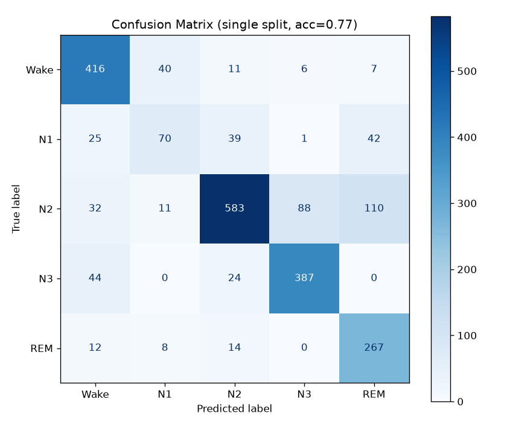
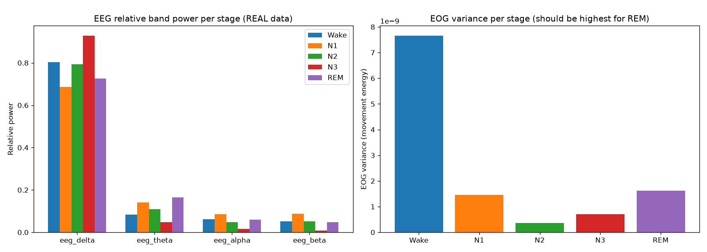
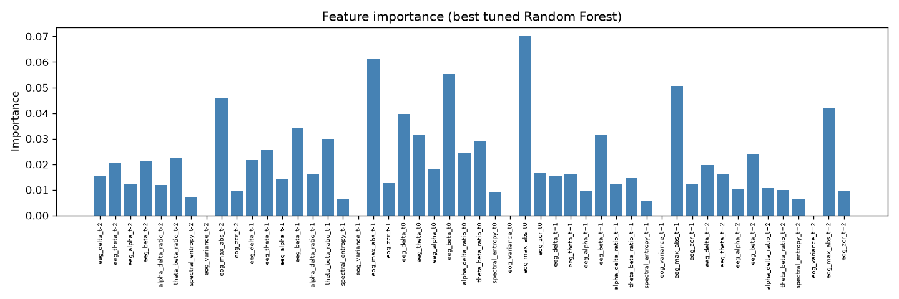
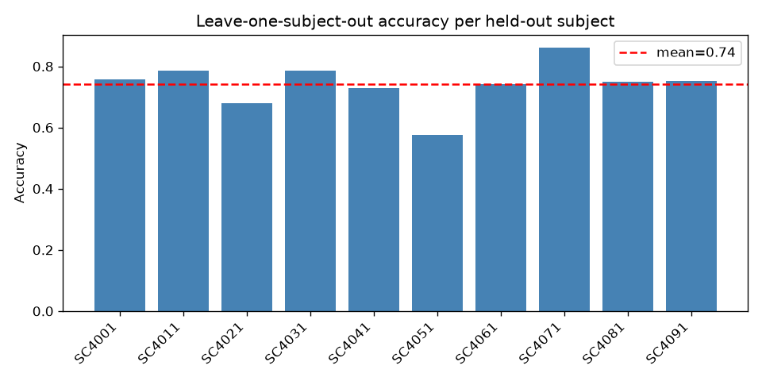

# EEG sleep stage classifier

This classifies 30-second windows of overnight EEG and EOG into the five standard sleep stages: Wake, N1, N2, N3 and REM. It runs on 10 recordings from the Sleep-EDF dataset and reaches 74.2% accuracy (± 7.1) when each subject is held out in turn.

I built it over a few days to learn EEG signal processing properly, not just to produce a number. Most of what I learned came from things going wrong, so those are written up below, after the results.



## Results

Leave-one-subject-out cross-validation, 10 folds, one person held out each time.

| Metric | Value |
|---|---|
| Accuracy | 74.2% (± 7.1) |
| Macro F1 | 0.689 (± 0.069) |
| Best / worst held-out subject | 86.1% (SC4071) / 57.6% (SC4051) |

Per-class results from a single split with 2 held-out subjects (2,237 test epochs, 77% overall accuracy):

| Stage | Precision | Recall | F1 |
|---|---|---|---|
| Wake | 0.79 | 0.87 | 0.82 |
| N1 | 0.54 | 0.40 | 0.46 |
| N2 | 0.87 | 0.71 | 0.78 |
| N3 | 0.80 | 0.85 | 0.83 |
| REM | 0.63 | 0.89 | 0.73 |

N1 is the weak spot. Its errors are spread over Wake, N2 and REM, the stages on either side of it, which is what you would expect from a brief transitional stage. Human scorers struggle with it too: in the AASM inter-scorer reliability program, agreement with the majority score was about 63% for N1, the lowest of any stage (Rosenberg and Van Hout, 2013). The biggest single confusion is N2 predicted as REM (110 epochs), which I have not explained yet.

Three models on the same split and the same features:

| Model | Accuracy | Macro F1 |
|---|---|---|
| Logistic regression | 0.781 | 0.751 |
| SVM (RBF) | 0.790 | 0.757 |
| Random forest | 0.778 | 0.731 |

They land within a point or two of each other, which says the features matter more than the choice of model. The grid-searched random forest in `train_model.py` scored 0.77 on the same split.

## How it works

**Preprocessing.** EEG (Fpz-Cz) and EOG (horizontal) are bandpass filtered at 0.3 to 35 Hz with a zero-phase Butterworth filter, then cut into 30-second epochs using the technicians' hypnogram labels. Movement and unscored epochs are dropped, and stage 4 is merged into N3.

**Features.** Ten per epoch: relative band power for delta, theta, alpha and beta, the alpha/delta and theta/beta ratios, spectral entropy, and three simple EOG statistics (variance, peak amplitude, zero-crossing rate). Each epoch is then concatenated with the two epochs before and after it, giving 50 features. Gamma is left out on purpose: at 100 Hz sampling there is very little of it to measure, and it is mostly muscle noise on a scalp recording.

**Validation.** Every split is by subject, never by epoch. Epochs from one person look a lot like each other, so a random split lets the model recognise the person instead of the sleep stage, and the accuracy comes out inflated.

## What went wrong along the way

**Wake everywhere.** The recordings run about 20 hours but the sleeping part is closer to 8, so roughly 75% of the epochs were Wake. A model can score well there by guessing Wake. I kept a 30-minute buffer around the sleep period and trimmed the rest, which took the dataset from 27,464 epochs to 9,913.

**Too much delta in Wake.** Before trusting anything I plotted average band power per stage. Wake had almost as much delta as N2, which makes no sense, since delta is the deep-sleep signature. Fpz-Cz sits near the eyes, and blinks leak into the slow frequencies. Switching from absolute to relative band power helped but did not fully fix it (plot below). I did not do proper artifact removal such as ICA.



**A ceiling around 50%.** With EEG features alone, all three models stalled at 49 to 54% accuracy. When unrelated models hit the same wall, the features are the problem. REM is defined by rapid eye movement, so an EEG-only model has no access to the thing that defines it. Adding EOG features and the neighbouring-epoch context took the same split to about 78%. In the final random forest, the peak EOG amplitude features at every time step are among the most important inputs, next to EEG beta power.



## Limitations

- One EEG channel and one EOG channel. Clinical scoring also uses chin EMG and more electrodes, so this is nowhere near clinical grade.
- Only 10 subjects, so one hard subject moves the average. SC4051 scored 57.6%, and the per-subject spread (below) is wide. Subjects range from 25 to 101 years old and sleep changes a lot with age, which may be part of it, but I have not tested that.
- The hyperparameter search used ordinary 3-fold cross-validation inside the training subjects, not subject-grouped folds, and the chosen settings were then reused in the leave-one-subject-out run. The 74.2% is probably very slightly optimistic. A nested, subject-grouped search would fix that.
- Hand-built features. Deep learning on the raw signal would likely do better with more data and compute.



## Running it

```bash
python -m venv venv
venv\Scripts\activate          # on Mac/Linux: source venv/bin/activate
pip install -r requirements.txt

python src/download_data.py --n-subjects 10
python src/process_all_subjects.py
python src/validate_preprocessing.py
python src/train_model.py
python src/compare_models.py
```

MNE may save the downloaded files to its own folder (`~/mne_data`) instead of `data/raw/`. If `process_all_subjects.py` finds nothing, copy the `.edf` files into `data/raw/`. To look inside one recording first: `python src/inspect_data.py <psg.edf> <hypnogram.edf>`.

`validate_preprocessing.py` also builds `all_subjects_combined.npz`, which the training scripts need. Plots and the trained model are not committed; running `train_model.py` regenerates them.

## Layout

```
assets/                   plots used in this README
data/raw/                 downloaded .edf files (not tracked)
data/processed/           per-subject .npz files (not tracked)
src/
  download_data.py        fetch Sleep-EDF through MNE
  inspect_data.py         print metadata and plot a raw snippet
  preprocess.py           filtering, epoching, wake trimming
  process_all_subjects.py batch preprocessing for every subject
  validate_preprocessing.py   sanity checks and plausibility plots
  extract_features.py     band power, ratios, entropy, EOG features, context
  train_model.py          tuned random forest, single split + leave-one-subject-out
  compare_models.py       logistic regression vs SVM vs random forest
RESULTS.md                longer write-up
LEARNING_ROADMAP.md       notes on the concepts behind each step
requirements.txt
```

## References

- Kemp B, Zwinderman AH, Tuk B, Kamphuisen HAC, Oberye JJL. Analysis of a sleep-dependent neuronal feedback loop: the slow-wave microcontinuity of the EEG. IEEE Trans Biomed Eng. 2000;47(9):1185-1194.
- Goldberger AL, et al. PhysioBank, PhysioToolkit, and PhysioNet. Circulation. 2000;101(23):e215-e220.
- Rosenberg RS, Van Hout S. The American Academy of Sleep Medicine inter-scorer reliability program: sleep stage scoring. J Clin Sleep Med. 2013;9(1):81-87.
- Gramfort A, et al. MEG and EEG data analysis with MNE-Python. Front Neurosci. 2013;7:267.